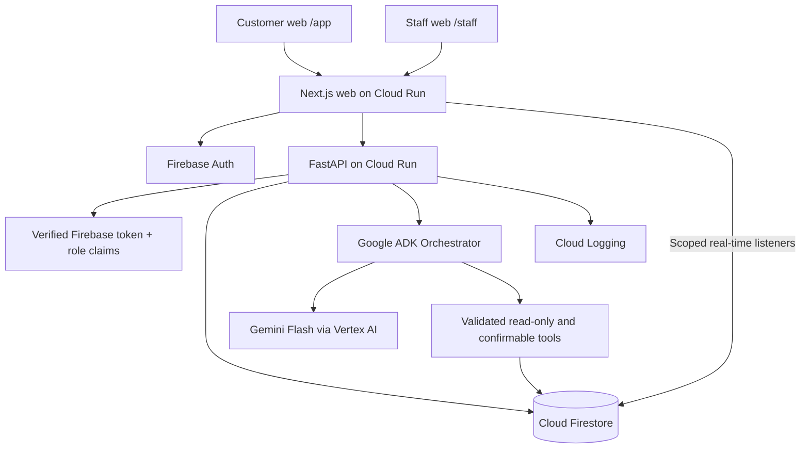

# AURA — ARCHITECTURE.md
## Decision: one Google-native cloud backend, expressive web frontend
**Frontend:** Next.js + TypeScript, Tailwind, R3F/Three.js for cinematic hero, Motion for app microinteraction. **Backend:** Python FastAPI + Google ADK, containerized and deployed to Cloud Run. **State:** Firestore. **Auth:** Firebase Auth. **AI:** supported Gemini Flash model via Vertex AI / Google Cloud endpoint. **Cloud:** Cloud Run, Artifact Registry, Cloud Logging; Firebase Hosting if a static-compatible frontend build is chosen. All hosted services are Google Cloud/Firebase. Open-source client animation libraries are permitted.

### Why the choices
- Next.js because Carbonexo-style 3D, scroll-driven storytelling and web performance fit its React ecosystem better than a Flutter Web-first implementation.
- FastAPI to integrate well-supported Google ADK Python tooling.
- Firestore for low-ops, event-driven shared state with transactions and real-time subscriptions.
- Rule-based queue/stock math for correctness; Gemini interprets intent, proposes choices, and explains grounded results.
- Cloud Run scale-to-zero to limit idle cost; consider cold starts during demo and use a warm-up step without increasing min instances unless approved.

## Service boundaries
`/api/v1/public/*` read-only public catalog (carefully controlled); `/api/v1/customer/*` own orders, preferences, reservations; `/api/v1/staff/*` role-checked order and inventory controls; `/api/v1/agent/plan` AI tool orchestration; `/api/v1/demo/*` admin-only isolated demo scenario.

### Security architecture
Firebase ID tokens verified in backend. Roles from trusted custom claims or server-managed membership records; client assertions never grant staff privilege. Firestore SDK listeners are constrained by Security Rules, preferably read-only for clients. Sensitive writes through authenticated Cloud Run; staff/manager separate permission scopes. Scoped `cafeId` on all documents and queries. Service accounts with narrow IAM. Restrict CORS. Rate limit agent endpoints. No API keys in frontend.

## Failure modes
- Gemini unavailable → browsing, cart, order flow and staff inventory work; show `AI temporarily unavailable`.
- Firestore update races → transaction retries and idempotency keys. No client-side promises of success before commit.
- Browser no WebGL → static hero and ordinary 2D seat map.
- No user sign-in → guest read-only demo with explicit controlled test identity (avoid fake auth for real writes).
- Cloud Run cold start → skeleton, bounded retries and understandable error.

## Region and model policy
Prefer `asia-south1` where supported. Validate selected Gemini Flash model ID, endpoint, quota and pricing from official docs *and* an authenticated smoke test before persisting it. Don't assume model alias works across regions. Global endpoint if supported, with documented latency/data residency tradeoff. Avoid unverified fixed model IDs.

## Budget
Preserve $5 USD initial cost target despite event credits; GCP budgets are alerts, **not spend cutoffs**. Cap Cloud Run max instances and Gemini request volume. Verify account/project/billing linkage before spending. Avoid paid managed vector search/Cloud SQL/scheduled jobs. Estimate Firestore reads/writes, Cloud Run requests, Gemini input/output tokens, logs and Artifact Registry storage. Confirm whether event credits apply to each SKU.
